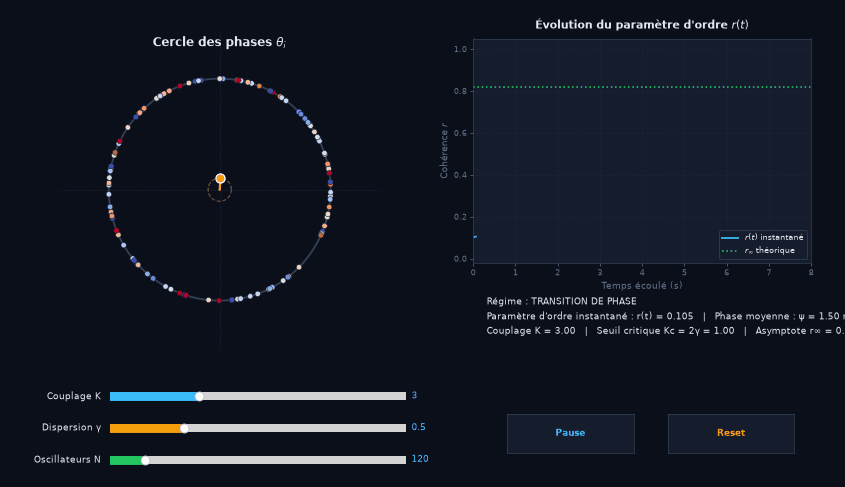

# KURA — Synchronisation des Oscillateurs (Modèle de Kuramoto)

Ce projet prolonge les travaux de recherche menés lors de mon **TIPE (Session 2025)** intitulé *« Étude de la synchronisation des oscillateurs »*.

Il propose une implémentation numérique complète, moderne et interactive du **modèle de Kuramoto**, enrichie par l'intégration d'un **retard temporel $\tau$**, d'une **connectivité cérébrale structurelle réelle (Connectome AAL 90 régions)**, d'une **synchronisation physique stricte sur le temps réel** et du **diagramme de stabilité des zones de synchronisation de Yeung & Strogatz (1999)** interactif au clic.

<p align="center">
  
  <br>
  <em>Simulation interactive : transition de phase vers l'état synchronisé et suivi en direct du paramètre d'ordre r(t).</em>
</p>

---

## Contexte physique & mathématique

### 1. Modèle standard de Kuramoto (champ moyen sans retard)

Le modèle de Kuramoto standard décrit $N$ oscillateurs de phases $\theta_i(t)$ et de pulsations propres $\omega_i$, couplés globalement par une intensité $K$ :

$$
\frac{d\theta_i}{dt} = \omega_i + \frac{K}{N}\sum_{j=1}^N \sin(\theta_j(t) - \theta_i(t))
$$

En introduisant le **paramètre d'ordre complexe** (champ moyen) :

$$
\vec{p}(t) = r(t)\,e^{i\psi(t)} = \frac{1}{N}\sum_{j=1}^N e^{i\theta_j(t)}
$$

où :
- $r(t) \in [0, 1]$ mesure le degré de cohérence (0 : désordre complet, 1 : synchronisation totale),
- $\psi(t)$ est la phase collective moyenne.

Pour une distribution de fréquences propres lorentzienne (loi de Cauchy) de demi-largeur $\gamma$, la théorie analytique de Kuramoto prédit un **couplage critique de transition de phase** :

$$
K_c = 2\gamma
$$

et un **paramètre d'ordre stationnaire asymptotique** :

$$
r_\infty = \begin{cases}
0 & \text{si } K \le K_c \\
\sqrt{1 - \frac{K_c}{K}} & \text{si } K > K_c
\end{cases}
$$

---

### 2. Extension : Retard temporel $\tau$ et connectivité structurelle du connectome cérébral

Dans les réseaux neuronaux réels, la propagation des influx le long des axones introduit une latence finie $\tau$, et les connexions synaptiques ne sont pas uniformes. L'équation dynamique devient :

$$
\frac{d\theta_i}{dt} = \omega_i + \frac{K}{N}\sum_{j=1}^N C_{ij}\sin(\theta_j(t - \tau) - \theta_i(t))
$$

où :
- $\tau \in [0, 10\pi]$ est le retard temporel de transmission,
- $C_{ij}$ est la matrice de connectivité structurelle (connectome cérébral humain à $N = 90$ régions corticales et sous-corticales de l'atlas AAL, issue de [Hopf_Delay_Toolbox](https://github.com/fcast7/Hopf_Delay_Toolbox.git)), normalisée de sorte que la moyenne des coefficients hors diagonale vaille 1 et $C_{ii} = 0$.

### 3. Diagramme des zones de synchronisation (Yeung & Strogatz, PRL 1999)

L'effet du retard temporel $\tau$ sur la synchronisation a été résolu analytiquement par M. K. S. Yeung et S. H. Strogatz (*Physical Review Letters*, 82(3), 648, 1999). Dans le plan $(\omega_0 \tau, K / \omega_0)$, des **langues d'instabilité (langues d'Arnold)** émergent aux retards impairs $\omega_0 \tau \approx (2m - 1)\pi$ :

- **Zone stable (Synchronie stable)** : synchronisation globale inconditionnellement stable. Pour $K / \omega_0 > 1$, la synchronie est garantie pour toute valeur de $\tau$.
- **Langue grise (Régime bistable)** : coexistence d'un état synchronisé et d'un état incohérent stable, délimitée par :

$$
\frac{(4m - 3)\pi}{2 - y} \le \omega_0\tau \le \frac{(4m - 1)\pi}{2 + y} \quad \text{avec} \quad y = \frac{K}{\omega_0} \le \frac{1}{2m - 1}
$$

- **Langue noire (Synchronie instable, incohérence stable)** : l'effet d'antiphase induit par le retard détruit la cohérence ($r \to 0$), délimitée par :

$$
\frac{(4m - 3)\pi}{2 - 2y} \le \omega_0\tau \le \frac{(4m - 1)\pi}{2 + 2y} \quad \text{avec} \quad y \le \frac{1}{2(2m - 1)}
$$

Un **point marqueur dynamique** sur le diagramme indique en temps réel la position courante $(\omega_0 \tau, K / \omega_0)$ du système. **On peut cliquer ou glisser directement sur le diagramme pour positionner instantanément le système dans la zone souhaitée.**

---

## Structure du dépôt

Le dépôt est structuré de cette manière :

- **`Etude_synchronisation_oscillateurs.pdf`** : Support de présentation du TIPE (Paul Laurent-Verleye, session 2025, 30 planches).
- **`kura.py`** : Simulateur interactif complet et 100% autonome à 3 panneaux :
  - **Matrice de connectivité cérébrale AAL (90 régions)** : issue du Human Connectome Project et de *Hopf_Delay_Toolbox*, directement intégrée sous forme d'un tableau NumPy `C_AAL_90` au sein du script (aucun fichier externe requis).
  - **Panneau gauche (Cercle des phases)** : oscillateurs $\theta_i$ sur le cercle unité, flèche et cercle doré représentant le paramètre d'ordre complexe $\vec{p}(t)$. **La couleur de chaque oscillateur dépend de son écart à la fréquence moyenne** : plus rouge lorsqu'il tourne à une vitesse proche de la fréquence moyenne, plus bleue lorsqu'il s'en éloigne.
  - **Dynamique continue sans réinitialisation intempestive** : le déplacement des curseurs et les clics sur le diagramme préservent l'état dynamique en cours des oscillateurs, permettant d'explorer le cycle d'hystérèse et la bistabilité en zone grise (le bouton **Reset** reste disponible pour forcer une réinitialisation manuelle).
  - **Panneau central (Affichage adaptatif selon le retard)** :
    - **Si $\tau = 0$ ($\omega_0\tau = 0$)** : Tracé en temps réel de l'évolution du paramètre d'ordre $r(t)$ avec une **traînée étendue sur 32 secondes** (4 fois plus longue, 8000 pas) et l'asymptote théorique $r_\infty$ affichée en continu.
    - **Si $\tau > 0$ ($\omega_0\tau > 0$)** : Bascule automatique vers un **histogramme de densité de l'écart à la phase collective moyenne $\rho(\theta - \psi)$** (36 bins sur $[-\pi, \pi]$), avec profil lissé par filtrage gaussien circulaire (`wrap`), repère fixe à 0 pour la phase moyenne collective $\psi$, et ligne horizontale d'incohérence uniforme $1/(2\pi)$. Ce repère tournant stabilise le pic synchronisé en 0 (sans défilement rotatif sur l'écran) et met en évidence instantanément les clusters secondaires (par exemple à $\pm\pi$).
  - **Panneau droit (Diagramme de Yeung & Strogatz)** : tracé analytique des zones de synchronisation avec sélection au clic/glisser pour fixer $(\omega_0\tau, K/\omega_0)$, verrouillé contre les déplacements parasites, à l'échelle exacte de la publication et assorti au thème sombre.
  - **Bouton Clusters (Multi-stabilité & Multi-pics)** : cycle entre `2 Clusters` (antiphase, 2 pics francs à $\pm\pi/2$), `3 Clusters` (tripolaire à $120^\circ$, 3 pics francs à $0$ et $\pm 2\pi/3$), `1 Cluster` (synchronie globale, 1 pic en $0$) et `Aléatoire` (état incohérent/splay).
  - **Phases initiales sur bande angulaire** : dans les modes multi-clusters, les phases ne sont pas infiniment superposées mais réparties aléatoirement sur une **bande angulaire compacte** ($\sim 43^\circ$ ou $0.75$ rad), formant des paquets visibles d'oscillateurs sur le cercle et des pics nets sur l'histogramme.
  - **Réseau Tous-à-tous permanent** : couplage global ($C_{ij} = 1 - \delta_{ij}$) garantissant rigoureusement la stabilité des attracteurs multi-clusters de Yeung & Strogatz pour tout $N$.
  - **Curseur de pulsation $\omega_0 \in [0, 10]$ rad/s** : contrôle en direct la vitesse angulaire réelle de rotation des oscillateurs ($T = 2\pi/\omega_0$).
  - **Curseur de couplage adimensionné $K / \omega_0 \in [0, 1]$** : paramètre vertical du diagramme de stabilité.
  - **Curseur de retard adimensionné $\omega_0 \cdot \tau \in [0, 10\pi]$** : paramètre horizontal du diagramme de stabilité.
  - **Synchronisation temps réel stricte** : l'intégration physique à pas fixe $dt = 0.005$ s est asservie à `time.perf_counter()`, garantissant qu'une seconde simulée équivaut rigoureusement à une seconde d'horloge réelle.
  - **Curseur de dispersion $\gamma \in [0, 2]$** et **oscillateurs $N \in [1, 1000]$**.
  - **Contrôles** : 3 boutons (`Clusters`, `Pause / Reprendre`, `Reset`).
- **`kuramoto_tipe.py`** : Moteur de simulation vectorisé permettant de reproduire numériquement toutes les figures de la présentation (instantanés du cercle, calcul statistique de $K_c$ avec barres d'incertitude, et relaxation temporelle).
- **`.gitignore`** : Fichiers temporaires et caches Python exclus.

---

## 🚀 Installation & Utilisation

### 1. Prérequis

Python 3.9+ avec les bibliothèques scientifiques :

```bash
pip install numpy scipy matplotlib
```

### 2. Lancer la simulation interactive (Kura)

```bash
python3 kura.py
```

- **Sélection au clic & Hystérèse** : Cliquez directement sur le diagramme de droite pour fixer $(K/\omega_0, \omega_0\tau)$ sans couper la dynamique en cours. Vous pouvez ainsi explorer les langues de Yeung & Strogatz, la bistabilité en zone grise et la multiplicité des états stationnaires.
- **Observation de plusieurs pics francs de phase** :
  - Cliquez sur le bouton violet **`Clusters`** pour naviguer entre :
    - `2 Clusters` : scinde les oscillateurs en deux groupes opposés ($\Delta\theta = \pi$), chacun étalé sur une bande de $\sim 43^\circ$ ($0.75$ rad), générant **deux pics verticaux très hauts et nets** à $-\pi/2$ et $+\pi/2$ ($r_2 \approx 1$).
    - `3 Clusters` : scinde les oscillateurs en trois groupes équidistants à $120^\circ$, chacun étalé sur une bande de $\sim 43^\circ$ ($0.75$ rad), générant **trois pics verticaux nets** à $0$ et $\pm 2\pi/3$ ($r_3 \approx 1$).
    - `1 Cluster` : état synchrone classique avec les oscillateurs regroupés sur une bande de $\sim 43^\circ$ autour de $0$ ($r_1 \approx 1$).
    - `Aléatoire` : phases dispersées uniformément sur $[-\pi, \pi]$ (densité plate autour de $1/(2\pi)$).
- **Réseau Tous-à-tous permanent** : le couplage global assure la symétrie exacte de permutation et la stabilité stricte des attracteurs à 2 et 3 clusters sous retard temporel $\tau$.
- **Bascule automatique de la fenêtre centrale** : Dès que $\omega_0\tau > 0$, la fenêtre centrale affiche la distribution de l'écart à la phase collective moyenne $\rho(\theta - \psi)$ avec détection automatique du régime (1 Cluster, 2 Clusters, 3 Clusters ou Incohérent). Dès que $\omega_0\tau = 0$, la fenêtre revient automatiquement au suivi temporel de $r(t)$ sur 32 s avec l'asymptote théorique $r_\infty$.

### 3. Exécuter les simulations analytiques du TIPE

```bash
# Générer toutes les figures de l'exposé (transition de phase, r(t), instantanés)
python3 kuramoto_tipe.py --fast

# Simulation haute résolution (N = 3000 oscillateurs)
python3 kuramoto_tipe.py --mode all
```

---

## Auteur

**Paul Laurent-Verleye**
