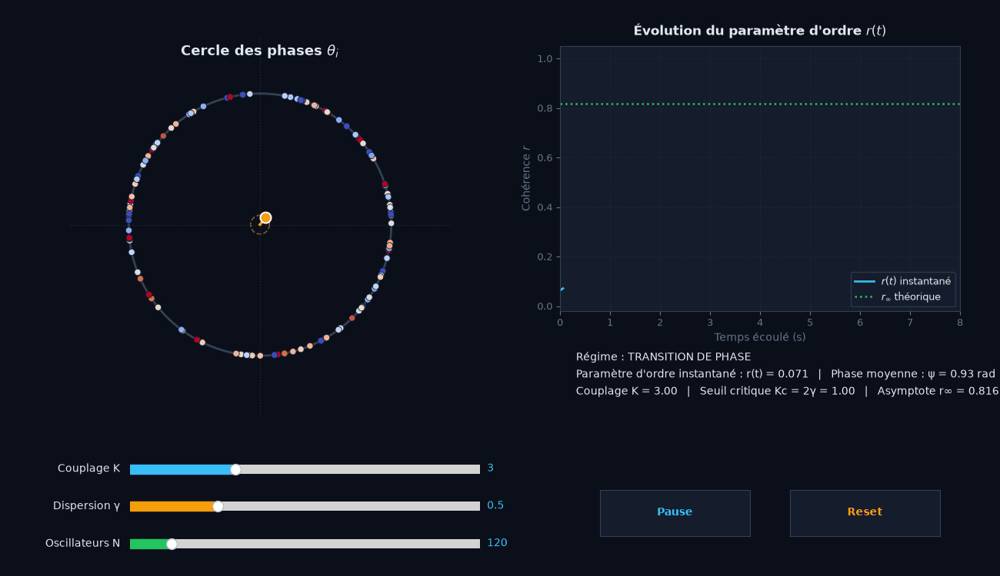

# KURA — Synchronisation des Oscillateurs (Modèle de Kuramoto)

Ce projet prolonge les travaux de recherche menés lors de mon **TIPE (Session 2025)** intitulé *« Étude de la synchronisation des oscillateurs »*.

Il propose une implémentation numérique complète, moderne et interactive du **modèle de Kuramoto**, décrivant l'émergence spontanée d'une synchronisation collective au sein d'une population d'oscillateurs couplés.

<p align="center">
  
  <br>
  <em>Simulation interactive avec 120 oscillateurs : transition de phase vers l'état synchronisé et suivi en direct du paramètre d'ordre $r(t)$.</em>
</p>

---

## Contexte physique & mathématique

Le modèle de Kuramoto décrit $N$ oscillateurs de phases $\theta_i(t)$ et de pulsations propres $\omega_i$, couplés globalement par une intensité $K$ :

$$
\frac{d\theta_i}{dt} = \omega_i + \frac{K}{N}\sum_{j=1}^N \sin(\theta_j(t) - \theta_i(t))
$$

En introduisant le **paramètre d'ordre complexe** (champ moyen) :

$$
\vec{p}(t) = r(t)\,e^{i\psi(t)} = \frac{1}{N}\sum_{j=1}^N e^{i\theta_j(t)}
$$

où :
- $r(t) \in [0, 1]$ mesure le degré de cohérence (0 : désordre complet, 1 : synchronisation totale),
- $\psi(t)$ est la phase collective moyenne.

L'équation de chaque oscillateur se simplifie en interaction avec le champ moyen :

$$
\frac{d\theta_i}{dt} = \omega_i + K\,r(t)\sin(\psi(t) - \theta_i(t))
$$

Pour une distribution de fréquences propres lorentzienne (loi de Cauchy) de demi-largeur $\gamma$, la théorie analytique de Kuramoto prédit un **couplage critique de transition de phase** :

$$
K_c = 2\gamma
$$

et un **paramètre d'ordre stationnaire asymptotique** :

$$
r_\infty = \begin{cases}
0 & \text{si } K \le K_c \\
\sqrt{1 - \frac{K_c}{K}} & \text{si } K > K_c
\end{cases}
$$

---

## Structure du dépôt

Le dépôt est structuré de cette manière :

- **`Etude_synchronisation_oscillateurs.pdf`** : Support de présentation du TIPE (Paul Laurent-Verleye, session 2025, 30 planches).
- **`kura.py`**  : Application interactive :
  - **Cercle unité des oscillateurs** : points colorés selon leur pulsation propre $\omega_i$, flèche et cercle doré représentant le paramètre d'ordre $\vec{p}(t)$. La taille des points s'adapte automatiquement à $N$.
  - **Slider du nombre d'oscillateurs $N \in [1, 1000]$** : ajuste la taille de la population en direct.
  - **Slider de couplage $K \in [0, 10]$** : intensité de couplage globale (transition de phase à $K_c = 2\gamma$).
  - **Slider de dispersion $\gamma \in [0, 2]$** : largeur de la distribution de Cauchy (débute à 0 pour une population homogène).
  - **Graphique dynamique de $r(t)$** avec comparaison en temps réel à l'asymptote théorique $r_\infty$.
  - **2 boutons de contrôle** : *Pause / Reprendre* et *Reset* (remise à zéro de la simulation).
- **`kuramoto_tipe.py`** : Moteur de simulation vectorisé permettant de reproduire numériquement toutes les figures de la présentation (instantanés du cercle, calcul statistique de $K_c$ avec barres d'incertitude, et relaxation temporelle).
- **`.gitignore`** : Fichiers temporaires et caches Python exclus.

---

## 🚀 Installation & Utilisation

### 1. Prérequis

Python 3.9+ avec les bibliothèques scientifiques usuelles :

```bash
pip install numpy scipy matplotlib
```

### 2. Lancer l'animation interactive (Kura)

```bash
python3 kura.py
```

**Faites glisser le curseur de couplage $K$ : en dessous de $K_c \approx 1.0$ (pour $\gamma = 0.5$), les oscillateurs dérivent de façon désordonnée. Au-delà de $K_c$, un amas synchronisé se forme et le barycentre se déploie vers l'extérieur.**

### 3. Exécuter les simulations analytiques et générer les figures du TIPE

```bash
# Générer toutes les figures de l'exposé (transition de phase, r(t), instantanés)
python3 kuramoto_tipe.py --fast

# Simulation haute résolution (N = 3000 oscillateurs)
python3 kuramoto_tipe.py --mode all
```

---

## Auteur

**Paul Laurent-Verleye**  
